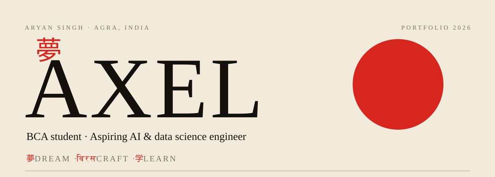

 

#### S T O R Y

BCA student at Sharda University, Agra, heading toward AI and data science. I like music and movies, and I'm interested in how AI and data science actually work.

#### W O R K

- **MUeRA** · AI academic companion for students, with **Team Pixel Clash** · [repo](https://github.com/thepixelclash/MUeRA)
- **Birthday Wish Website** · mobile-first celebration pages · [repo](https://github.com/meetaxel/birthday-wish-website)
- More experiments in [my repositories](https://github.com/meetaxel?tab=repositories)

#### S K I L L S

#### P A T H

BCA today, AI and data science engineering next. Learning in public, one project at a time.

#### C O N T A C T

