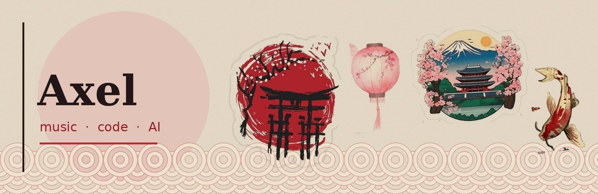

# Hey, I'm Axel

**BCA Student · Aspiring AI & Data Science Engineer**

I like music and movies, and I'm interested in how AI and data science work.

## What I'm up to

- Studying BCA and heading toward AI and data science
- Part of **The Pixel Clash** team behind [MUeRA](https://github.com/thepixelclash/MUeRA), an AI academic companion for students
- Made a mobile-first [birthday website](https://github.com/meetaxel/birthday-wish-website) with HTML, CSS and JavaScript
